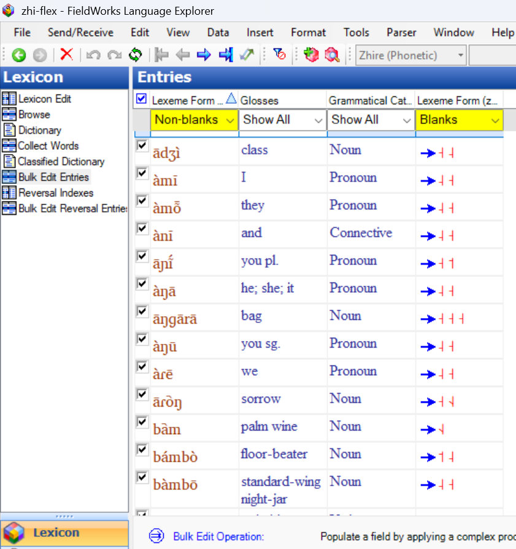
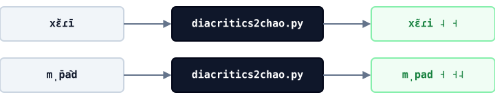
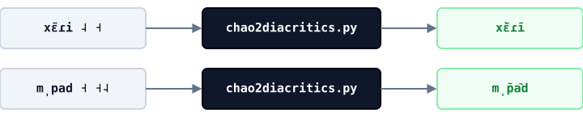

# flex-string-converters



String converters for linguistic data. The primary way to use one is directly inside SIL FieldWorks Language Explorer (FLEx), as a FLEx Process run over a whole column of lexicon data. Each converter also runs from the command line on its own, and can also be used with FlexTools.

The current modules include:
- `chao-tone-letters`: Convert from diacritic tone marks to Chao tone letters and back again
- `cv-patterns`: Convert from a phonemic (or phonetic) transcription to CV patterns
- `zhire`: Convert from phonetic to phonemic to orthographic (language specific example)

These modules are in development. Please back up your FLEx project before running any of them.

## Installation

To install [this repository](https://github.com/speechchemistry/flex-string-converters), scroll up to the green code box, click it and then click Download ZIP. You can then extract it on your computer (e.g. from the Downloads folder).

You will need to ensure that Python is installed on your computer. At the time of writing, [Python 3.13](https://www.python.org/downloads/latest/python3.13/) is recommended because Flex supports version 3.9 - 3.13. You will also need to install any third-party package the chosen converter needs, for example type `pip install regex` for the `chao-tone-letters` converters. Each converter's section below names the packages it needs.

<video src="https://github.com/user-attachments/assets/8f6cf6a8-01c9-45f7-96ca-168f3232d0a3" controls="controls"></video>

This video shows how to use the Bulk Edit Entries → Process → Setup... to setup the `diacritics2chao_tone_letters_only` process (one of `chao-tone-letters/`'s converters). It is just a case of specifying the Python script file and the Python DLL file. (It is best not to use different DLL files in one Flex session as you might need to restart Flex to use each different module) 

## `chao-tone-letters/`

Converting between tone diacritics and Chao tone letters. Not specific to any one language.

### `diacritics2chao.py`



Strips tone diacritics from the input and appends its Chao tone letters, e.g. `nə̀jɛ᷅t` → `nəjɛt ˨ ˨˧`. As a FLEx Process this is the `diacritics2chao` process. Point at `diacritics2chao_attached.py` instead for the `--attached` form below, or `diacritics2chao_tone_letters_only.py` for the tone letters alone with no base text.

`--attached` writes each tone letter after the syllable it marks instead of gathering them into a trailing section:

```
$ python3 chao-tone-letters/converters/diacritics2chao.py --attached 'nə̀jɛ᷅t'
nə˨jɛ˨˧t
```

It needs the `regex` package (`pip install regex`).

It's also available as the FlexTools module `Extract_Chao_tone_letters_from_tone_diacritics.py` to demonstrate how these converters can be used with FlexTools.

### `chao2diacritics.py`



Reverses `diacritics2chao.py`: places Chao tone letters back onto their base text as tone diacritics, e.g. `nəjɛt ˨ ˨˧` → `nə̀jɛ᷅t`. As a FLEx Process this is the `chao2diacritics` process.

Where the tone letters sit doesn't matter — attached to their syllable, gathered before or after the text, or a mixture all give the same result. A line that doesn't correspond to a valid tone-letter reading (an unaccounted syllable, or a contour with no diacritic equivalent) is returned unchanged rather than partially converted, with a warning to stderr naming the line.

```
$ python3 chao-tone-letters/converters/chao2diacritics.py 'ma ti ˦  ˦˨' 'ma˦ ti˦˨'
má tî
má tî
```

It needs the same `regex` package as `diacritics2chao.py`.

## `cv-patterns/`

Turning a phonemic (or phonetic) transcription into its CV pattern. Not specific to any one language, and deliberately small: the output alphabet is just `C` and `V`. 

### `phonemes2cv.py`

Turns a transcription into its consonant/vowel pattern, e.g. `nə̀jɛt` → `CVCVC`. As a FLEx Process this is the `phonemes2cv` process. Tone diacritics and tone letters (including `diacritics2chao.py`'s own output) are recognised and contribute nothing, so the two projects compose:

```
$ python3 cv-patterns/converters/phonemes2cv.py 'nəjɛt ˨ ˨˧'
CVCVC
```

A tie bar joins two symbols into one phone (`t͡ʃa` → `CV`); without one, the same letters are two phones (`tʃa` → `CCV`). That is a deliberate choice for now, not a bug. An unrecognised symbol becomes `?` with a warning produced in the command line version.

It needs the [`segments`](https://pypi.org/project/segments/) package (`pip install segments`), a tokeniser from Moran & Cysouw's Unicode Cookbook.

## `zhire/`

A second, smaller project — mainly here to illustrate what's possible for a language with its own orthography, rather than the day-to-day tool the `chao-tone-letters/` converters above are. It converts a Zhire `[zhi]` phonetic or phonemic transcription to its orthographic spelling; the two converters compose: phonetic → phonemic → orthography.

`phonetic2phonemic.py` applies the Zhire phonology sketch's allophony and notation rules to turn a phonetic transcription into a phonemic one, e.g. `ɲápsə́` → `njápsə́` (the `phonetic2phonemic` FLEx Process). `phonemic2orthography.py` then strips tone diacritics (the orthography has no tone-marking convention yet) and maps the phonemic string to its orthographic spelling, e.g. `hwōrì` → `whori` (the `phonemic2orthography` FLEx Process). Both raise an error naming the offending input if a symbol or sequence isn't covered, rather than passing it through unchanged or dropping it silently.

These Zhire examples were built partly to test a way of keeping the conversion simple: constraining it to a single, well-defined pattern — a finite-state transducer, built with the `pynini` package. However this does complicate the installation process especially on Windows. See [`zhire/SPEC.md`'s Installing Pynini section](zhire/SPEC.md#installing-pynini).

## Adding a new converter

1. Decide whether it belongs in an existing project folder or needs a new one. For a new project folder, see the [`adding-a-project`](.claude/skills/adding-a-project/SKILL.md) skill, which scaffolds `<project>/{SPEC.md, converters/, tests/}`.
2. Add `<project>/converters/<what_it_converts>.py` with a `Convert(input_string)` function and a command line interface, and no `flextoolslib` or FieldWorks import.
3. Add `<project>/tests/test_<what_it_converts>.py` covering `Convert()` directly, and once the CLI has realistic output, approval fixtures under `<project>/tests/fixtures/<what_it_converts>/` (see [`adding-an-approval-fixture`](.claude/skills/adding-an-approval-fixture/SKILL.md)).
4. If it should run over a whole lexicon as a FlexTools module, follow the [`adding-a-flextools-module`](.claude/skills/adding-a-flextools-module/SKILL.md) skill to wrap it starting from `__Template_converter_module.py`.
5. Update the project's `SPEC.md` (and the root [SPEC.md](SPEC.md) index, if it's a new project) and this README in the same change.

See [AGENTS.md](AGENTS.md) for the full contributor conventions and [SPEC.md](SPEC.md) for the index of what each project's converters and modules guarantee.

## Tests

Run `python -m pytest` from the repository root, which discovers every project's own `tests/` folder in one run, plus the repository-wide `tests/` holding only the shared approval-testing harness.

To run just one project's tests, point pytest at that project's `tests/` folder, e.g. `python -m pytest cv-patterns/tests/`.

If you have held-out data — real input plus its independently correct output, add it as a fixture directly: drop the input as a `.txt` file into `<project>/tests/fixtures/<converter>/inputs/` and drop the already-known-correct output straight into `<project>/tests/fixtures/<converter>/approved/` under the same filename with a `.approved.txt` extension, e.g. create the files:

```
cv-patterns/tests/fixtures/phonemes2cv/inputs/chumburung.txt
cv-patterns/tests/fixtures/phonemes2cv/approved/chumburung.approved.txt
```

Then run `python -m pytest`. A failure here means the converter is wrong (or the ground truth is). The error message can be a lot to read, so it's often easier to 'diff' the output file against approved file. The following example also includes the input to make it easier to read: 

Linux/bash:
```
$ git diff --no-index --word-diff <(paste cv-patterns/tests/fixtures/phonemes2cv/inputs/chumburung.txt cv-patterns/tests/fixtures/phonemes2cv/received/chumburung.received.txt) <(paste cv-patterns/tests/fixtures/phonemes2cv/inputs/chumburung.txt cv-patterns/tests/fixtures/phonemes2cv/approved/chumburung.approved.txt)
```

Windows/powershell:
```
[Console]::OutputEncoding = [System.Text.Encoding]::UTF8
$enc = [System.Text.Encoding]::UTF8
$in  = [System.IO.File]::ReadAllLines((Resolve-Path "cv-patterns/tests/fixtures/phonemes2cv/inputs/chumburung.txt"), $enc)
$rec = [System.IO.File]::ReadAllLines((Resolve-Path "cv-patterns/tests/fixtures/phonemes2cv/received/chumburung.received.txt"), $enc)
$app = [System.IO.File]::ReadAllLines((Resolve-Path "cv-patterns/tests/fixtures/phonemes2cv/approved/chumburung.approved.txt"), $enc)
for ($i = 0; $i -lt $in.Count; $i++) {
    if ($rec[$i] -ne $app[$i]) {
        Write-Host "$($in[$i])" -NoNewline
        Write-Host "  received=$($rec[$i])" -ForegroundColor Red -NoNewline
        Write-Host "  approved=$($app[$i])" -ForegroundColor Green
    }
}
```

## License

MIT — see [LICENSE](LICENSE). The one exception is `chao-tone-letters/Extract_Chao_tone_letters_from_tone_diacritics.py`, which incorporates code fragments by C D Farrow and is licensed under LGPL 2.1 instead; see that file's header.

**Attributions:** `cv-patterns/converters/cv_profile.tsv` is generated from CLTS's BIPA transcription system (List, Anderson, Tresoldi, Rzymski & Forkel; CC-BY-4.0; DOI [10.5281/zenodo.3515744](https://doi.org/10.5281/zenodo.3515744)) — see [`cv-patterns/SPEC.md`'s Licensing and attribution section](cv-patterns/SPEC.md#licensing-and-attribution) for the full credit and what was changed.

